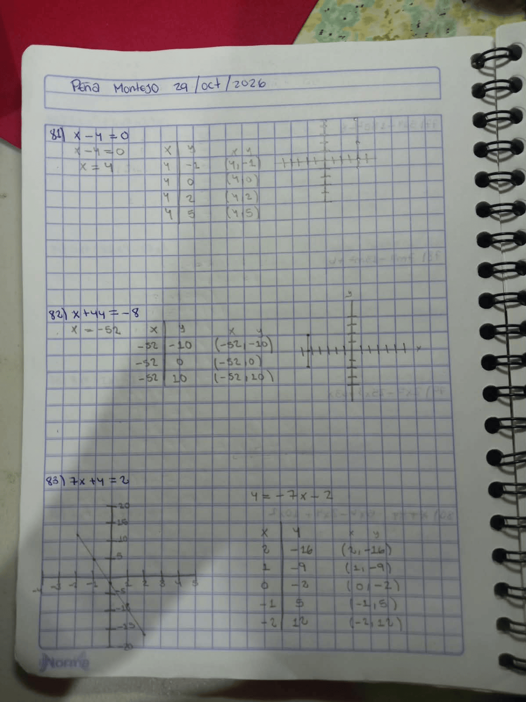
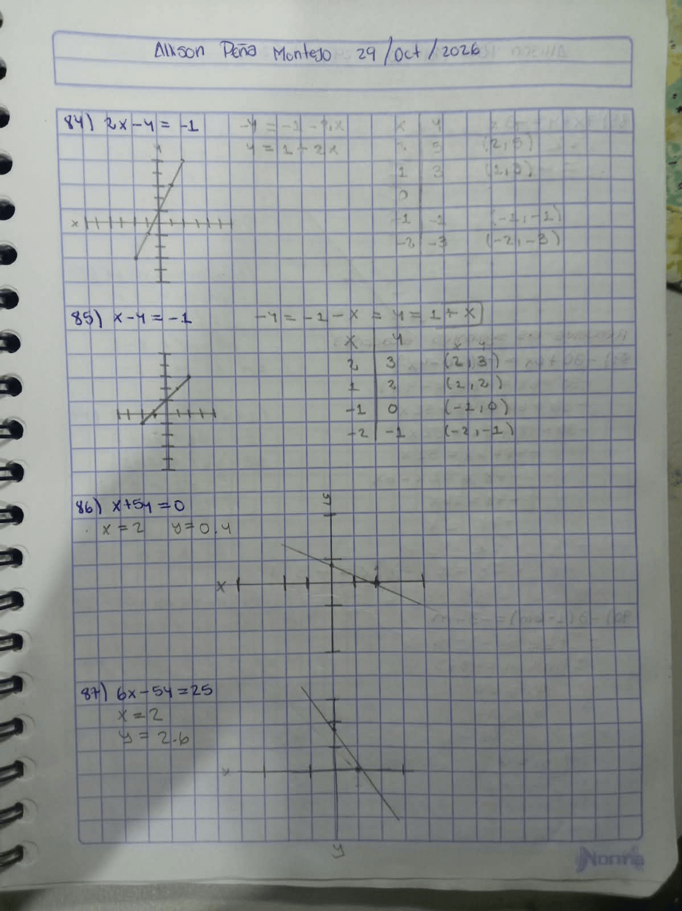
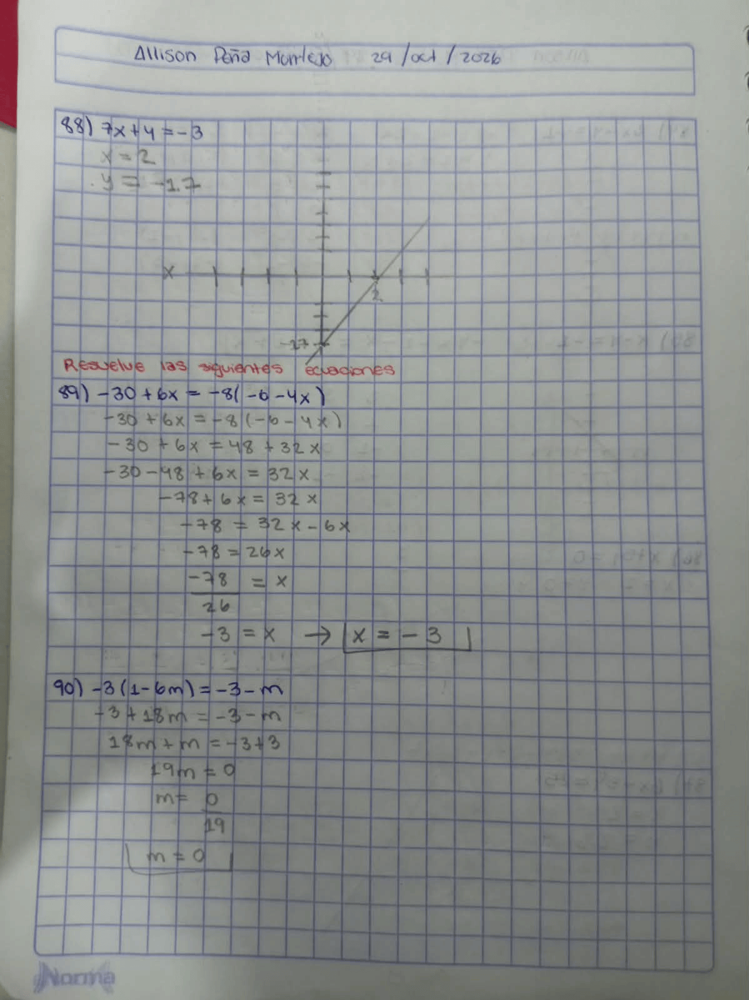

# Serie de Ejercicios – Unidad 2 (ejercicios 81 a 128)

Allison Peña Montejo  
29/oct/2026  
Fundamentos de Álgebra
---

## Ejercicios 81 a 88: Gráficas de ecuaciones lineales

### 81) $x - y = 0$

$$
\begin{aligned}
x - 4 &= 0\\
x &= 4
\end{aligned}
$$

| $x$ | $y$ | Punto |
|:---:|:---:|:-----:|
| 4 | −1 | (4, −1) |
| 4 | 0 | (4, 0) |
| 4 | 2 | (4, 2) |
| 4 | 5 | (4, 5) |

---

### 82) $x + 44 = -8$

$$
x = -52
$$

| $x$ | $y$ | Punto |
|:---:|:---:|:-----:|
| −52 | −10 | (−52, −10) |
| −52 | 0 | (−52, 0) |
| −52 | 10 | (−52, 10) |

---

### 83) $7x + y = -2$

$$
y = -7x - 2
$$

| $x$ | $y$ | Punto |
|:---:|:---:|:-----:|
| 2 | −16 | (2, −16) |
| 1 | −9 | (1, −9) |
| 0 | −2 | (0, −2) |
| −1 | 5 | (−1, 5) |
| −2 | 12 | (−2, 12) |

---

### 84) $2x - y = -1$

$$
\begin{aligned}
-y &= -1 - 2x\\
y &= 1 + 2x
\end{aligned}
$$

| $x$ | $y$ | Punto |
|:---:|:---:|:-----:|
| 2 | 5 | (2, 5) |
| 1 | 3 | (1, 3) |
| 0 |   | |
| −1 | −1 | (−1, −1) |
| −2 | −3 | (−2, −3) |

---

### 85) $x - y = -1$

$$
\begin{aligned}
-y &= -1 - x\\
y &= 1 + x
\end{aligned}
$$

| $x$ | $y$ | Punto |
|:---:|:---:|:-----:|
| 2 | 3 | (2, 3) |
| 1 | 2 | (1, 2) |
| −1 | 0 | (−1, 0) |
| −2 | −1 | (−2, −1) |

---

### 86) $x + 5y = 0$

Para $x = 2$: $y = -0.4$

---

### 87) $6x - 5y = 25$

Para $x = 2$: $y = -2.6$

---

### 88) $7x + y = -3$

Para $x = 2$: $y = -17$

### GRAFICAS

---

## Ejercicios 89 a 104: Resolver las siguientes ecuaciones

### 89) $-30 + 6x = -8(-6 - 4x)$

$$
\begin{aligned}
-30 + 6x &= -8(-6 - 4x)\\
-30 + 6x &= 48 + 32x\\
-30 - 48 + 6x &= 32x\\
-78 + 6x &= 32x\\
-78 &= 32x - 6x\\
-78 &= 26x\\
\frac{-78}{26} &= x\\
-3 &= x
\end{aligned}
$$

$$\boxed{x = -3}$$

---

### 90) $-3(1 - 6m) = -3 - m$

$$
\begin{aligned}
-3 + 18m &= -3 - m\\
18m + m &= -3 + 3\\
19m &= 0\\
m &= \frac{0}{19}
\end{aligned}
$$

$$\boxed{m = 0}$$

---

### 91) $x - 8(x - 2) = 11 - 8x$

$$
\begin{aligned}
x - 8x + 16 &= 11 - 8x\\
-7x + 16 &= 11 - 8x\\
-7x + 8x &= 11 - 16\\
x &= -5
\end{aligned}
$$

$$\boxed{x = -5}$$

---

### 92) $10 - 8x = 6x + 2(6x - 8)$

$$
\begin{aligned}
10 - 8x &= 6x + 12x - 16\\
10 - 8x &= 18x - 16\\
10 + 16 &= 18x + 8x\\
26 &= 26x\\
\frac{26}{26} &= x\\
1 &= x
\end{aligned}
$$

$$\boxed{x = 1}$$

---

### 93) $7 + 3n = -4 + 4(n + 3)$

$$
\begin{aligned}
7 + 3n &= -4 + 4n + 12\\
7 + 3n &= 8 + 4n\\
7 - 8 &= 4n - 3n\\
-1 &= n
\end{aligned}
$$

$$\boxed{n = -1}$$

---

### 94) $2 + 5x = 2(8x + 1)$

$$
\begin{aligned}
2 + 5x &= 16x + 2\\
2 - 2 &= 16x - 5x\\
0 &= 11x\\
\frac{0}{11} &= x\\
0 &= x
\end{aligned}
$$

$$\boxed{x = 0}$$

---

### 95) $-1 - 3(1 + 5k) = -26 + 7k$

$$
\begin{aligned}
-1 - 3 - 15k &= -26 + 7k\\
-4 - 15k &= -26 + 7k\\
-4 + 26 &= 7k + 15k\\
22 &= 22k\\
\frac{22}{22} &= k\\
1 &= k
\end{aligned}
$$

$$\boxed{k = 1}$$

---

### 96) $-20 + x = 6x - 5(6x - 1)$

$$
\begin{aligned}
-20 + x &= 6x - 30x + 5\\
-20 + x &= -24x + 5\\
x + 24x &= 5 + 20\\
25x &= 25\\
x &= \frac{25}{25}
\end{aligned}
$$

$$\boxed{x = 1}$$

---

### 97) $\dfrac{493}{32} - \dfrac{13}{8}x = -\dfrac{7}{4}\left(-\dfrac{11}{6}x + \dfrac{29}{8}\right)$

$$
\begin{aligned}
\frac{493}{32} - \frac{13}{8}x &= \frac{77}{24}x - \frac{203}{32}\\[4pt]
1479 - 156x &= 308x - 609\\
1479 + 609 &= 308x + 156x\\
2088 &= 464x\\
x &= \frac{2088}{464}\\[4pt]
x &= 4.5
\end{aligned}
$$

$$\boxed{x = \frac{9}{2}}$$

---

### 98) $\dfrac{5}{3} + x = -\dfrac{7}{6}\left(x - \dfrac{9}{5}\right)$

$$
\begin{aligned}
\frac{5}{3} + x &= \left(-\frac{7}{6}\cdot x\right) + \left(-\frac{7}{6}\cdot -\frac{9}{5}\right)\\[4pt]
\frac{5}{3} + x &= -\frac{7}{6}x + \frac{63}{30}\\[4pt]
\frac{5}{3} + x &= -\frac{7}{6}x + \frac{21}{10}\\[4pt]
30\left(\frac{5}{3}\right) + 30(x) &= 30\left(-\frac{7}{6}x\right) + 30\left(\frac{21}{10}\right)\\[4pt]
10(5) + 30x &= 5(-7x) + 3(21)\\
50 + 30x &= -35x + 63\\
50 + 65x &= 63\\
65x &= 13\\
x &= \frac{13}{65}
\end{aligned}
$$

$$\boxed{x = \frac{1}{5}}$$

---

### 99) $-\dfrac{96}{35} - \dfrac{4}{3}f = \dfrac{24}{7}\left(\dfrac{14}{3}f - \dfrac{4}{5}\right)$

$$
\begin{aligned}
-\frac{96}{35} - \frac{4}{3}f &= \left(\frac{24}{7}\cdot\frac{14}{3}f\right) - \left(\frac{24}{7}\cdot\frac{4}{5}\right)
\end{aligned}
$$

Productos auxiliares:

$$
\frac{24}{7}\cdot\frac{14}{3} = \frac{336}{21} = 16
\qquad\qquad
\frac{24}{7}\cdot\frac{4}{5} = \frac{96}{35}
$$

$$
\begin{aligned}
-\frac{96}{35} - \frac{4}{3}f &= 16f - \frac{96}{35}\\[4pt]
-\frac{4}{3}f &= 16f\\[4pt]
0 &= 16f + \frac{4}{3}f\\[4pt]
0 &= \left(\frac{48}{3} + \frac{4}{3}\right)f\\[4pt]
0 &= \frac{52}{3}f
\end{aligned}
$$

$$\boxed{f = 0}$$

---

### 100) $-\dfrac{11}{4}\left(-\dfrac{1}{2}x + 1\right) = -\dfrac{5}{4} + \dfrac{3}{8}x$

$$
\begin{aligned}
\left(-\frac{11}{4}\cdot -\frac{1}{2}x\right) + \left(-\frac{11}{4}\cdot 1\right) &= -\frac{5}{4} + \frac{3}{8}x\\[4pt]
\frac{11}{8}x - \frac{11}{4} &= -\frac{5}{4} + \frac{3}{8}x\\[4pt]
8\left(\frac{11}{8}x\right) - 8\left(\frac{11}{4}\right) &= 8\left(-\frac{5}{4}\right) + 8\left(\frac{3}{8}x\right)\\[4pt]
11x - 22 &= -10 + 3x\\
8x - 22 &= -10\\
8x &= 12\\
x &= \frac{12}{8}
\end{aligned}
$$

$$\boxed{x = \frac{3}{2}}$$

---

### 101) $-\dfrac{3}{2}r - \dfrac{317}{48} = -\dfrac{19}{8}\left(r + \dfrac{10}{3}\right)$

$$
\begin{aligned}
-\frac{3}{2}r - \frac{317}{48} &= -\frac{19}{8}r - \frac{190}{24}\\[4pt]
48\left(-\frac{3}{2}r\right) - 48\left(\frac{317}{48}\right) &= 48\left(-\frac{19}{8}r\right) - 48\left(\frac{190}{24}\right)\\[4pt]
-72r - 317 &= -114r - 380\\
42r - 317 &= -380\\
42r &= -63\\
r &= -\frac{63}{42}
\end{aligned}
$$

$$\boxed{r = -\frac{3}{2}}$$

---

### 102) $-\dfrac{7}{6}\left(r + \dfrac{13}{7}\right) = -\dfrac{103}{30} + 2r$

$$
\begin{aligned}
-\frac{7}{6}r - \frac{91}{42} &= -\frac{103}{30} + 2r
\end{aligned}
$$

Simplificando $-\dfrac{91}{42} = -\dfrac{13}{6}$:

$$
\begin{aligned}
-\frac{7}{6}r - \frac{13}{6} &= -\frac{103}{30} + 2r\\[4pt]
30\left(-\frac{7}{6}r\right) - 30\left(\frac{13}{6}\right) &= 30\left(-\frac{103}{30}\right) + 30(2r)\\[4pt]
-35r - 65 &= -103 + 60r\\
-65 &= -103 + 95r\\
38 &= 95r\\
r &= \frac{38}{95}
\end{aligned}
$$

$$\boxed{r = \frac{2}{5}}$$

---

### 103) $\dfrac{13}{7}\left(f + \dfrac{17}{8}\right) = \dfrac{23}{5}f + \dfrac{241}{280}$

$$
\begin{aligned}
\frac{13}{7}f + \frac{221}{56} &= \frac{23}{5}f + \frac{241}{280}\\[4pt]
280\left(\frac{13}{7}f\right) + 280\left(\frac{221}{56}\right) &= 280\left(\frac{23}{5}f\right) + 280\left(\frac{241}{280}\right)\\[4pt]
520f + 1105 &= 1288f + 241\\
1105 &= 768f + 241\\
864 &= 768f\\
f &= \frac{864}{768}
\end{aligned}
$$

$$\boxed{f = \frac{9}{8}}$$

---

### 104) $-\dfrac{7}{6}n + \dfrac{7}{75} = -\dfrac{7}{5}\left(\dfrac{1}{2}n - \dfrac{2}{5}\right)$

$$
\begin{aligned}
-\frac{7}{6}n + \frac{7}{75} &= -\frac{7}{10}n + \frac{14}{25}\\[4pt]
150\left(-\frac{7}{6}n\right) + 150\left(\frac{7}{75}\right) &= 150\left(-\frac{7}{10}n\right) + 150\left(\frac{14}{25}\right)\\[4pt]
-\frac{7}{6}n + \frac{7}{10}n &= \frac{14}{25} - \frac{7}{75}\\[4pt]
\frac{-35n + 21n}{30} &= \frac{42 - 7}{75}\\[4pt]
-\frac{14}{30}n &= \frac{35}{75}\\[4pt]
-\frac{7}{15}n &= \frac{7}{15}\\[4pt]
n &= \frac{7}{15}\cdot\left(-\frac{15}{7}\right)
\end{aligned}
$$

$$\boxed{n = -1}$$

---

## Ejercicios 105 a 110

### 105) Norachai tarda 12 h y De Shawn tarda 8 h. ¿Cuánto tardan juntos?

$$
\begin{aligned}
\frac{1}{12} + \frac{1}{8} &= \frac{2}{24} + \frac{3}{24} = \frac{5}{24}\\[4pt]
t &= \frac{24}{5} = 4.8\ \text{h}
\end{aligned}
$$

$$\boxed{t = 4.8\ \text{h}}$$

---

### 106) Shanice tarda 13 h; Eduardo tarda $e$ h. Juntos tardan 4.95 h.

$$
\begin{aligned}
\frac{1}{13} + \frac{1}{e} &= \frac{1}{4.95}\\[4pt]
64.35 &= 13\cdot 4.95\\
4.95e + 64.35 &= 13e
\end{aligned}
$$
---

### 107) $\dfrac{1}{15} + \dfrac{1}{x} = \dfrac{1}{5.22}$

$$
\begin{aligned}
\frac{1}{x} &= \frac{1}{5.22} - \frac{1}{15}\\[4pt]
\frac{1}{x} &= \frac{15 - 5.22}{15\cdot 5.22}\\[4pt]
\frac{1}{x} &= \frac{9.78}{78.3}\\[4pt]
x &= \frac{78.3}{9.78}
\end{aligned}
$$

$$\boxed{x = 8\ \text{hr}}$$

---

### 108) $\dfrac{1}{10} + \dfrac{1}{15} = \dfrac{1}{x}$

$$
\begin{aligned}
\frac{3}{30} + \frac{2}{30} &= \frac{1}{x}\\[4pt]
\frac{5}{30} &= \frac{1}{x}\\[4pt]
\frac{1}{6} &= \frac{1}{x}
\end{aligned}
$$

$$\boxed{x = 6\ \text{hr}}$$

---

### 109) Stefan tarda 9 hr y Eugene 15 hr. ¿Cuántas horas tardan juntos?

$$
\begin{aligned}
\frac{1}{9} + \frac{1}{15} &= \frac{1}{x}\\[4pt]
\frac{5}{45} + \frac{3}{45} &= \frac{1}{x}\\[4pt]
\frac{8}{45} &= \frac{1}{x}\\[4pt]
x &= \frac{45}{8} = 5.625
\end{aligned}
$$

$$\boxed{x \approx 5.63\ \text{hr}}$$

---

### 110) Jack tarda 16 hrs; Carlos tarda $c$ hrs. Juntos tardan 7.74 hrs.

$$
\begin{aligned}
\frac{7.74}{16} + \frac{7.74}{c} &= 1\\[4pt]
7.74c + 123.84 &= 16c\\
7.74c - 16c &= -123.84\\
c &= \frac{-123.84}{-8.26} \approx 14.99
\end{aligned}
$$

$$\boxed{c = 15\ \text{hrs}}$$

---

## Ejercicios 111 a 128: Problemas de aplicación

### 111) Stephanie tarda 8 h y Jessica 11 h.

$$
\begin{aligned}
\frac{1}{8} + \frac{1}{11} &= \frac{11}{88} + \frac{8}{88} = \frac{19}{88}\\[4pt]
t &= \frac{88}{19} \approx 4.63\ \text{h}
\end{aligned}
$$

$$\boxed{t \approx 4.63\ \text{h}}$$

---

### 112) Mike tarda 10 h; Jaldes tarda $J$ h. Juntos tardan 5.65 h.

$$
\begin{aligned}
\frac{1}{J} + \frac{1}{10} &= \frac{1}{5.65}\\[4pt]
56.5 &= 4.35J\\
J &\approx 13
\end{aligned}
$$

$$\boxed{J = 13\ \text{h}}$$

---

### 113) Shanice va a 74 km/h durante 3 h; la distancia total es 298 km. Daniel va a 76 km/h.

$$
\begin{aligned}
\text{Shanice: } & 74\cdot 3 = 222\ \text{km}\\
\text{Daniel: } & 298 - 222 = 76\ \text{km}\\
t &= \frac{76}{76} = 1\ \text{h}
\end{aligned}
$$

$$\boxed{t = 1\ \text{h}}$$

---

### 114) Ida: 6 h. Regreso: 9 h a 12 km/h. ($v$ = velocidad de ida)

$$
\begin{aligned}
6v &= 9\cdot 12\\
6v &= 108\\
v &= 18
\end{aligned}
$$

$$\boxed{v = 18\ \text{km/h}}$$

---

### 115) Brenda sale 1 h después, va a 75 mph y alcanza a Shayna tras 2 h.

$$
\begin{aligned}
2 + 1 &= 3\ \text{h}\\
3s &= 2\cdot 75\\
3s &= 150\\
s &= 50
\end{aligned}
$$

$$\boxed{s = 50\ \text{mph}}$$

---

### 116) Ida a 55 km/h, regreso a 44 km/h. La ida tarda 1 h menos. ($t$ = horas de ida)

$$
\begin{aligned}
55t &= 44(t + 1)\\
55t &= 44t + 44\\
11t &= 44\\
t &= 4
\end{aligned}
$$

$$\boxed{t = 4\ \text{h}}$$

---

### 117) Rob sale 1 h antes. Julia va a $(r - 30)$. Después de 1 h están a 180 km.

$$
\begin{aligned}
R &= 2r\\
J &= 1(r - 30)\\
2r + r - 30 &= 180\\
3r &= 210\\
r &= 70
\end{aligned}
$$

$$\boxed{r = 70\ \text{km/h}}$$

---

### 118)

$$
\begin{aligned}
11c + 5005 &= 7480\\
11c &= 7480 - 5005\\
c &= \frac{2475}{11}
\end{aligned}
$$

$$\boxed{c = 225\ \text{km/h}}$$

---

### 119)

$$
\begin{aligned}
17t + 29t &= 552\\
46t &= 552\\
t &= 12
\end{aligned}
$$

$$\boxed{t = 12\ \text{hrs}}$$

---

### 120)

$$
\begin{aligned}
6v &= 4(v + 15)\\
6v &= 4v + 60\\
6v - 4v &= 60\\
2v &= 60\\
v &= 30
\end{aligned}
$$

$$\boxed{v = 30\ \text{km/h}}$$

---

### 121)

$$
\begin{aligned}
0.88x + 12 &= 0.96(x + 12)\\
0.88x + 12 &= 0.96x + 11.52\\
-0.08x &= -0.48\\
x &= 6
\end{aligned}
$$

$$\boxed{x = 6\ \text{libras}}$$

---

### 122)

$$
\begin{aligned}
7p + 1.7 &= 2.4\\
7p &= 2.4 - 1.7\\
7p &= 0.7\\
p &= 0.1
\end{aligned}
$$

$$\boxed{p = 0.1}$$

---

### 123)

$$
\begin{aligned}
0.34 + 6s &= 1.12\\
6s &= 1.12 - 0.34\\
6s &= 0.78\\
s &= 0.13
\end{aligned}
$$

$$\boxed{s = 0.13}$$

---

### 124)

$$
\begin{aligned}
0.04x &= 0.05(4 + x)\\
0.04x &= 0.2 + 0.05x\\
0.04x &= 0.2\\
x &= 5
\end{aligned}
$$

$$\boxed{x = 5\ \text{galones}}$$

---

### 125)

$$
\begin{aligned}
4p + 8 &= 24\\
4p &= 24 - 8\\
4p &= 16\\
p &= 4
\end{aligned}
$$

$$\boxed{p = \$4\ \text{por onza}}$$

---

### 126)

$$
\begin{aligned}
3p + 0 &= 0.6\\
p &= 0.2
\end{aligned}
$$

$$\boxed{p = 0.2}$$

---

### 127)

$$
\begin{aligned}
5.4 + 12p &= 11.4\\
12p &= 11.4 - 5.4\\
12p &= 6\\
p &= 0.5
\end{aligned}
$$

$$\boxed{p = 0.5}$$

---

### 128)

$$
\begin{aligned}
0.41x + 0.11 &= 0.35(x + 1)\\
&= 0.35x + 0.35\\
0.41x - 0.35x &= 0.35 - 0.11
\end{aligned}
$$
